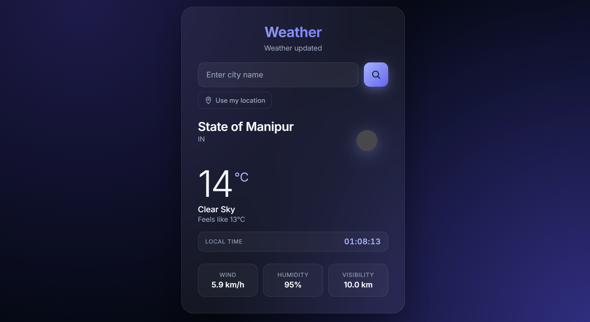

# 🌤️ WeatherSnap

> A clean, modern weather app that adapts to the sky — literally.

WeatherSnap is a lightweight, framework-free weather application that fetches
real-time conditions for any city on Earth (or your current location) and
paints the entire interface with a theme that matches the weather outside.

---

## ✨ Features

- 🌍 **Auto-detect location** — opens with your local weather on load
  (graceful fallback to manual search if you decline)
- 🎨 **Dynamic weather themes** — the background, accents, and glow colors
  shift smoothly between clear, cloudy, rainy, snowy, stormy, misty, and
  night-time palettes
- 🕐 **Live local time** for the searched city, ticking every second
- 🌡️ **Human-readable units** — °C, km/h, km visibility, % humidity
- 🔎 **Search any city** by name or use the "Use my location" button
- ⚡ **Zero dependencies** — pure HTML, CSS, and vanilla JavaScript
- 💎 **Glassmorphism UI** — blurred card, layered gradients, subtle motion
- 📱 **Fully responsive** — looks sharp from phone to desktop
- ♿ **Accessible** — `aria-live` results, labeled controls, semantic markup

---

## 🖼️ Preview


> The card fades in, the theme morphs on each search, and the clock ticks live.

---

## 🚀 Getting Started

### 1. Clone or download

```bash
git clone https://github.com/your-username/weathersnap.git
cd weathersnap